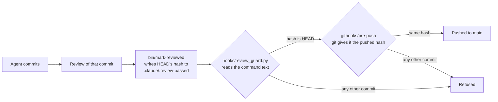

# commit-bound-review

Guards for a repository where coding agents write the code. Two rules, both in
code rather than in the instructions the agent reads:

1. **A review counts for one exact commit.** A push to `main` needs a review
   stamped with the hash of the commit being pushed. One more commit, the small
   fix after the review included, and the review no longer counts. A deploy
   command needs the same of the checkout it is run from.
2. **No git command that throws away uncommitted work.** `git checkout .`,
   `git restore`, `git reset --hard`, `git clean -f` and `git switch -f` are
   refused while the tree has uncommitted changes; dropping a stash and
   `git clean -x` (which deletes ignored files such as `.env`) are refused
   always.

For Claude Code (PreToolUse hooks) and git. Python 3.9+ and bash, no
dependencies.

What the agent gets back when a guard refuses:

```
[review-guard] Blocked: the review is for 261cf3e3, but HEAD is e38da791. A commit was made after the review: review again.
[dirty-tree-guard] Blocked: destructive git command while the tree has uncommitted changes. Commit first, or ask the user.
```

## Why

Both rules were instructions first. An instruction is a request; a hook runs
before the command.

- On 24 August 2026 an agent ran a checkout to undo a test change, and wiped
  uncommitted edits with it. The rule "don't do that" was already written down.
- A review of "the branch" is a review of whatever the branch becomes. Agents
  commit fast, and a fix made after the review ships unreviewed unless
  something compares hashes.

The longer account, with what a review agent broke along the way:
[AI agents write almost all of my code](https://yussieik.com/notes/review-bound-to-the-commit/).
These files are a generic version of what runs in two of my repositories; the
push rule has been there since April 2026.

**Why not branch protection and required checks alone?** Use them too; they
are the lock on the server side. These guards sit earlier, where the agent
works: the refusal arrives before the command runs, with the reason, so the
agent can go back and review instead of pushing and failing later.
And they hold in a repository where pushes go straight to `main` with no pull
request, which is how the repositories this comes from work.

## How it works



| File | Runs | What it does |
|---|---|---|
| `bin/mark-reviewed` | at the end of your review | Writes HEAD's hash to `.claude/.review-passed`. Refuses on a dirty tree. |
| `hooks/review_guard.py` | before each Bash call of the agent | Early stop: a line that pushes to `main`, runs a deploy workflow, or pushes with git's hooks switched off is refused unless the marker is HEAD. |
| `githooks/pre-push` | in git, before every push | The exact check: git passes the hash being pushed, and it must be the marker's. |
| `hooks/dirty_tree_guard.py` | before each Bash call of the agent | Refuses the commands of rule 2. `checkout -b`, `checkout --ours/--theirs`, `restore --staged`, `clean -n`, a plain `switch` and everything else pass. |

There are two guards on a push because they know different things. The hook
in the agent sees only the text of a command, so it can stop early and explain
why, but it can be walked past. Git knows which commit it is pushing, whatever
the command looked like.

This repository ships the lock, not the review. What "reviewed" means is
yours to decide: a review skill, a script, a person. Mine is a skill that
runs separate code, simplicity and security reviews in fresh context, fixes
what must be fixed, reviews again, and stamps the commit only after a clean
last pass.

## Install

From a clone of this repository, in your own repository's root:

```sh
mkdir -p .claude/hooks githooks bin
cp path/to/commit-bound-review/hooks/*.py .claude/hooks/
cp path/to/commit-bound-review/githooks/pre-push githooks/
cp path/to/commit-bound-review/bin/mark-reviewed bin/
echo ".claude/.review-passed" >> .gitignore
git config core.hooksPath githooks      # once per clone
```

`core.hooksPath` replaces `.git/hooks` for this clone. If you already have
hooks there or use a hook manager (husky, lefthook, pre-commit), call
`githooks/pre-push` from your existing pre-push hook instead of setting it,
and pass it the hook's arguments and standard input: git lists the pushed
commits there.

Commit the copied files: `bin/mark-reviewed` refuses a tree with uncommitted
changes, these included.

Register the two hooks in `.claude/settings.json`
([`examples/settings.json`](examples/settings.json)):

```json
{
  "hooks": {
    "PreToolUse": [
      {
        "matcher": "Bash",
        "hooks": [
          { "type": "command", "command": "python3 \"$CLAUDE_PROJECT_DIR/.claude/hooks/dirty_tree_guard.py\"", "timeout": 10 },
          { "type": "command", "command": "python3 \"$CLAUDE_PROJECT_DIR/.claude/hooks/review_guard.py\"", "timeout": 10 }
        ]
      }
    ]
  }
}
```

Then make `bin/mark-reviewed` the last step of your review.

To change the branch or what counts as a deploy, edit `BRANCH` and
`DEPLOY_NAME` at the top of `hooks/review_guard.py` and `branch` in
`githooks/pre-push`. By default a deploy is a line that names a workflow
containing "deploy" and says `workflow ... run` or `dispatches`. Add your
workflow's numeric ID to `DEPLOY_NAME` if it can be run by ID, and any other
command that ships (`make deploy`, `fly deploy`) if you have one. Re-running
an earlier deploy run (`gh run rerun <id>`) is not seen: the line names no
workflow.

## What it does not do

- **It is not a lock against a dishonest agent.** The agent can write the
  marker itself, or switch git's hooks off in one call (`git config
  core.hooksPath ...`) and push in the next. It is a lock against the two
  failures that happen in practice: a review step skipped, and one more commit
  after the review.
- **Only the push is bound to an exact commit.** For a deploy the guard checks
  the checkout the command is run from; it does not know which commit the
  workflow builds (`gh workflow run deploy.yml --ref another-branch`). Make the
  deploy workflow itself refuse a commit that is not on `main`.
- **`main` can change without a push.** `gh pr merge` or a ref update through
  the API, run by the agent or by anyone, passes through neither guard. Protect
  the branch on the server if those are possible in your setup.
- **The text guard has known gaps.** Text built at run time (`$var`,
  `echo main | xargs git push origin`, brace expansion, an empty command
  substitution inside a word), a quoted `;` or `|` between `git` and `push`,
  and a bare `git push` on `main` get past it. For pushes `githooks/pre-push`
  catches all of these; a deploy command has only the text guard.
- **It over-blocks on purpose.** A line that only mentions a push to `main`
  needs a valid marker too: inside `echo`, in a commit message
  (`git commit -m "retry the push to main"`), or a branch named
  `feature/main`. So does a push line that also names a directory outside a
  reviewed checkout (`cd .. && git push origin main`). That is the price of
  matching text instead of parsing shell, and of failing closed.
- **The dirty-tree guard checks the session's own directory,** and reads the
  words of the line as written. A line that first moves to another repository
  is judged by the wrong tree, and a command built at run time is not seen.
  Neither are other ways to lose work: `git rm -f`, `git checkout-index -f`,
  `git apply -R`, an alias. It over-blocks a little too: `git checkout
  other-branch` is refused on a dirty tree although git itself would carry the
  changes over or stop, and so is a line of prose that reads like one of the
  commands (`echo git checkout . is dangerous`, or a heredoc saying so).

## Why one guard reads text and the other parses

The first version of the review guard split each command with a shell
tokenizer and looked for a push or a deploy among the words. Review agents,
asked to review changes to the guard itself, kept finding forms that hid one:
a second line, a subshell, `bash -c`, `eval`, `env` and `sudo` prefixes, a
line piped into `bash`, `xargs`, a backslash inside a word. Each round of
special cases left another composed form through. So it stopped parsing: it
drops quotes and backslashes and matches the text. A miss there ships
unreviewed code, so it errs toward blocking. The forms that got past earlier
versions are now the test list.

The dirty-tree guard goes the other way. Its job is to stop an accident, not
an adversary, and a guard that refuses `git commit -m "fix checkout flow"`
gets switched off. So it splits the line into words and reads git's
subcommand and flags.

## Tests

```sh
python3 -m unittest discover tests -v
```

21 tests, stdlib only, against real temporary git repositories:

- 60 command forms that must be refused from an unreviewed checkout
- pushes and deploys allowed from a reviewed one, and refused again after one
  more commit
- real pushes through `githooks/pre-push`, including the bare `git push` the
  text guard cannot see
- 30 destructive forms refused on a dirty tree and allowed on a clean one, 21
  harmless ones allowed on a dirty tree, and 5 refused even on a clean tree

## License

MIT
