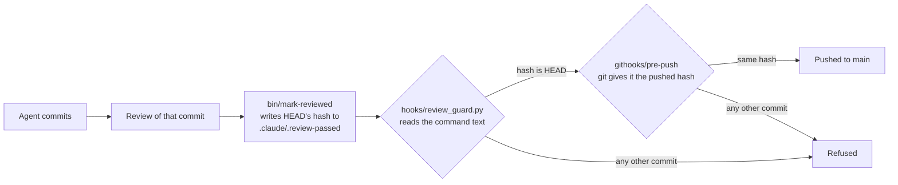

# commit-bound-review

Guards for a repository where coding agents write the code. Two rules, both in
code rather than in the instructions the agent reads:

1. **A review counts for one exact commit.** A push to `main` or a deploy needs
   a review stamped with that commit's hash. One more commit, the small fix
   after the review included, and the review no longer counts.
2. **No destructive git command on a dirty tree.** `git checkout .`,
   `git reset --hard` and the like are refused while there are uncommitted
   changes.

For Claude Code (PreToolUse hooks) and git. Python 3.9+ and bash, no
dependencies.

## Why

Both rules were instructions first. An instruction is a request; a hook runs
before the command.

- On 24 August 2026 an agent ran a checkout to undo a test change, and wiped
  uncommitted edits with it. The rule "don't do that" was already written down.
- A review of "the branch" is a review of whatever the branch becomes. Agents
  commit fast, and a fix made after the review ships unreviewed unless
  something compares hashes.

The longer account, with what a review agent broke along the way:
[AI agents write almost all of my code](https://yussieik.com/notes/review-bound-to-the-commit/).
These files are a generic version of what runs in two of my repositories; the
push rule has been there since April 2026.

## How it works



| File | Runs | What it does |
|---|---|---|
| `bin/mark-reviewed` | at the end of your review | Writes HEAD's hash to `.claude/.review-passed`. Refuses on a dirty tree. |
| `hooks/review_guard.py` | before each Bash call of the agent | Early stop: a line that pushes to `main` or runs a deploy workflow is refused unless the marker is HEAD. |
| `githooks/pre-push` | in git, before every push | The exact check: git passes the hash being pushed, and it must be the marker's. |
| `hooks/dirty_tree_guard.py` | before each Bash call of the agent | Refuses `checkout`, `restore`, `reset --hard`, `stash drop/clear`, `branch -D` while the tree is dirty. `checkout -b` passes. |

There are two guards on a push because they know different things. The hook
in the agent sees only the text of a command, so it can stop early and explain
why, but it can be walked past. Git knows which commit it is pushing, whatever
the command looked like.

## Install

From a clone of this repository, in your own repository's root:

```sh
mkdir -p .claude/hooks githooks bin
cp path/to/commit-bound-review/hooks/*.py .claude/hooks/
cp path/to/commit-bound-review/githooks/pre-push githooks/
cp path/to/commit-bound-review/bin/mark-reviewed bin/
echo ".claude/.review-passed" >> .gitignore
git config core.hooksPath githooks      # once per clone
```

Register the two hooks in `.claude/settings.json`
([`examples/settings.json`](examples/settings.json)):

```json
{
  "hooks": {
    "PreToolUse": [
      {
        "matcher": "Bash",
        "hooks": [
          { "type": "command", "command": "python3 \"$CLAUDE_PROJECT_DIR/.claude/hooks/dirty_tree_guard.py\"", "timeout": 10 },
          { "type": "command", "command": "python3 \"$CLAUDE_PROJECT_DIR/.claude/hooks/review_guard.py\"", "timeout": 10 }
        ]
      }
    ]
  }
}
```

Then make `bin/mark-reviewed` the last step of whatever your review is: a
review skill, a script, a person. Mine is a skill that runs separate code,
simplicity and security reviews in fresh context, fixes what must be fixed,
reviews again, and stamps the commit only after a clean last pass.

To change the branch or what counts as a deploy, edit `BRANCH` and
`DEPLOY_NAME` at the top of `hooks/review_guard.py` and `branch` in
`githooks/pre-push`. By default a deploy is any line that names a workflow
containing "deploy" and says `workflow ... run` or `dispatches`.

## What it does not do

- **It is not a lock against a dishonest agent.** The agent can write the
  marker itself, and `git push --no-verify` skips git's hook. It is a lock
  against the failures worth planning for: a step skipped, or one more commit
  after the review.
- **The text guard has known gaps.** Text built at run time (`$var`,
  `echo main | xargs git push origin`, brace expansion), a quoted `;` or `|`
  between `git` and `push`, and a bare `git push` on `main` get past it. For
  pushes `githooks/pre-push` catches all of these; a deploy command has only
  the text guard.
- **It over-blocks on purpose.** A line that only quotes a push to `main`
  (inside `echo`, say) needs a valid marker too. That is the price of matching
  text instead of parsing shell.
- **A pull request merged on the hosting side never passes through either
  guard.** Protect the branch there as well if you merge that way.
- **The dirty-tree guard checks the session's own directory.** A line that
  first moves to another repository is judged by the wrong tree.

## Why it reads text instead of parsing the command

The first version split each command with a shell tokenizer and looked for a
push or a deploy among the words. Review agents, asked to review changes to
the guard itself, kept finding forms that hid one: a second line, a subshell,
`bash -c`, `eval`, `env` and `sudo` prefixes, a line piped into `bash`,
`xargs`, a backslash inside a word. Each round of special cases left another
composed form through. So it stopped parsing: it drops quotes and backslashes
and matches the text. The forms that got past earlier versions are now the
test list.

## Tests

```sh
python3 -m unittest discover tests -v
```

18 tests, stdlib only, each against real temporary git repositories: 55
command forms that must be refused from an unreviewed checkout, the same
commands allowed from a reviewed one, a review voided by one more commit, real
pushes through `githooks/pre-push`, and the dirty-tree cases.

## License

MIT
